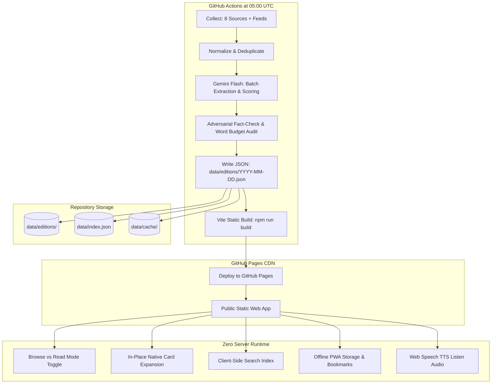

# ARCHITECTURE: Lotus Daily Intelligence Brief

Lotus employs an ultra-lean, **zero-cost static architecture** pairing serverless GitHub scheduled actions with client-side reactive rendering.

---

## Architecture Flow Diagram

---

## Core Principles

1. **Zero Recurring Infrastructure Cost ($0.00):**
   - GitHub Actions compute: Free tier (public repository).
   - GitHub Pages hosting: Free tier (unlimited bandwidth for reasonable static assets).
   - Google Gemini API: Free tier (Flash model with rate-limit batching).
   - Database: Plain versioned JSON files committed to Git.

2. **Decoupled Visitor Experience:**
   - Website visitors **never** trigger LLM calls or server compute.
   - All AI synthesis is precomputed at build time. The user loads static JSON in milliseconds.

3. **Deterministic Verification:**
   - Every number, entity, and funding round must exist in raw source excerpts.
   - An adversarial verification step flags any hallucinated claims before publishing.
